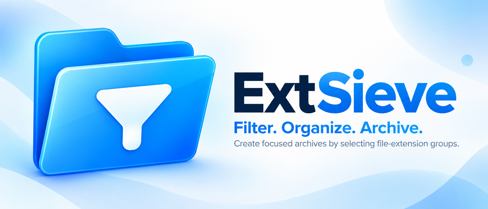
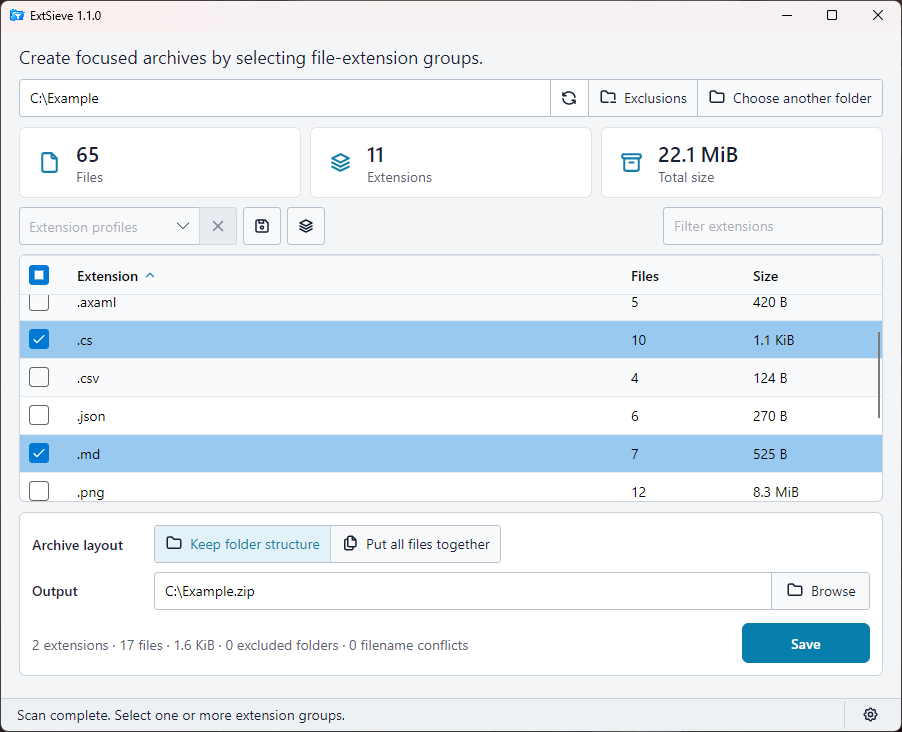
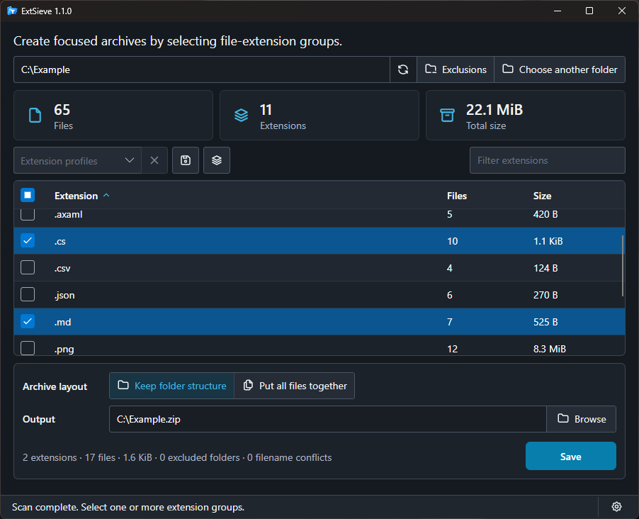

<p align="center">
  
</p>

# ExtSieve

**Filter. Organize. Archive.**

ExtSieve is a lightweight desktop utility for building focused ZIP archives from
selected file extensions. Choose a folder, scan it, select the extension groups you
want, and save a clean archive without modifying the source.

[](#packaging)
[](#packaging)
[](#supported-languages)
[](LICENSE)
[](#build-from-source)

## Screenshot





Actual ExtSieve 1.1.0 main window — Light and Dark themes, using example folders.

## Features

- Scan folders recursively and group files by extension.
- Filter, sort, and select extension groups, including all groups at once with the
  global selector.
- Keep the original folder structure or place selected files together.
- Handle flat-layout filename conflicts safely and deterministically.
- Create ZIP archives without modifying source files.
- Save named extension profiles and select one to replace the current selection.
- Exclude exact relative subfolders before scanning their contents.
- View the build's source commit and open GitHub Releases from Settings / About.
- Check for a newer stable release manually; open its page without automatic downloads.

## Supported languages

- English
- Italiano
- Deutsch
- Français
- Español
- Português (Brasil)

## Basic usage

1. Choose a source folder to scan.
2. Filter, sort, and select the extension groups to include.
3. Choose whether to keep the original folder structure or place all selected files
   together.
4. Choose the output ZIP destination.
5. Select **Save**.

Use the **Save profile** icon to store the selected extension groups for reuse. Choosing
a profile immediately replaces the entire selection, including rows hidden by the
filter. Missing extensions are ignored; new scans clear the profile and selection.
The adjacent **Deselect profile** X clears only the picker, keeping selected extension
groups and saved profiles unchanged without confirmation. The management icon opens
renaming, duplication, and confirmed deletion.
Each icon has a tooltip; application feedback appears in the status bar.

Use **Exclusions** beside the source folder to browse and check subfolders to skip.
Each checked folder excludes its whole subtree. **Apply** rescans with the changed
exclusions and clears the previous extension selection. Exclusions are remembered per
source folder, independently from extension profiles.
Use **Show only excluded** to review and uncheck configured relative paths, including
missing directories. It combines with search; **Reset changes** restores the opening draft.

## Build from source

Requirements:

- .NET 10 SDK; the repository selects a stable SDK through `global.json`.

Run from this directory:

```shell
dotnet restore ExtSieve.sln --locked-mode
dotnet build ExtSieve.sln --configuration Release --no-restore
dotnet test --solution ExtSieve.sln --configuration Release --no-build --no-restore
dotnet run --project src/ExtSieve.App/ExtSieve.App.csproj
```

About reads only the explicitly supplied `PublicSourceRevision` assembly metadata.
Without it, builds show a localized **Development build** value. Private development
revisions and informational-version suffixes are never used as a fallback. A supplied
public revision must be the full 40-character hexadecimal release-source commit SHA; About
shows seven characters and links to that public commit. The app version remains 1.1.0.
Installed and portable applications never query Git or fetch a commit from GitHub.

## Packaging

The release artifact set is designed for normal installation and portable use:

- Windows x64: installer (`.exe`) or portable archive (`.zip`).
- Linux x64: Debian package (`.deb`), RPM package (`.rpm`), or portable archive
  (`.tar.gz`) for compatible glibc-based distributions.

The current Windows installer is not digitally signed. Windows may display an
"Unknown publisher" or Microsoft Defender SmartScreen warning. SHA-256 checksums are
provided to verify downloaded file integrity; they do not provide the publisher
identity assurance of Authenticode signing.

<details>
<summary>Package commands and output details</summary>

Create the Windows x64 portable package and installer (Inno Setup 7.1.0 required):

```powershell
powershell -NoProfile -ExecutionPolicy Bypass -File scripts/publish-windows.ps1
```

Create the glibc Linux x64 portable, DEB, and RPM packages (nFPM 2.47.0 required):

```bash
./scripts/publish-linux.sh
```

These default commands create development packages. Release configuration alone does
not mark a build as public. Release candidates are prepared from a clean, audited
checkout of an approved immutable source commit. Record its full commit SHA before
building; the commit can be prepared locally before publication. Use that exact
checkout and supply its SHA explicitly:

```powershell
./scripts/publish-windows.ps1 -PublicReleaseBuild -PublicSourceRevision $publicCommit
```

```bash
PUBLIC_RELEASE_BUILD=true PUBLIC_SOURCE_REVISION="$public_commit" ./scripts/publish-linux.sh
```

The equivalent direct publish uses `-p:PublicReleaseBuild=true`
`-p:PublicSourceRevision=<full-public-commit>`. Both scripts pass the same properties
through restore, build, tests, and publish. Validation runs before packaging changes
any output: public builds require a revision, any supplied revision must be valid,
and public publication cannot use `--no-build` to reuse an assembly with stale metadata.
No command infers a public revision from the local checkout or verifies it over the
network. Confirm that the supplied SHA identifies the exact source being built.
Changing the commit after compilation invalidates the candidate packages, even if
the file contents are unchanged. Complete source, package, provenance and platform
verification before publication. Distribute the same verified package bytes only
after their exact source commit is independently confirmed in the public repository
and the release is approved; do not rebuild packages during publication.

Both scripts restore locked dependencies, build and test Release, then write versioned
artifacts, sorted SHA-256 file manifests, and per-artifact checksum sidecars under
`artifacts/releases/<version>/candidate/` (Git-ignored). Existing outputs are preserved;
choose a fresh output directory for another build. Windows accepts `-ArtifactDirectory`
and `-WorkDirectory`; Linux accepts `EXTSIEVE_ARTIFACT_DIRECTORY` and
`EXTSIEVE_WORK_DIRECTORY`. Relative overrides resolve from the calling directory.
Work must be a fresh directory separate from the output, and defaults to a unique OS
temporary directory. It holds publish/native staging and is printed by the script.
Verify the promoted packages before removing task-owned staging; preserve failed work
until diagnosis. Normal build/restore intermediates remain in project bin/obj.
Final published assets and unchanged sidecars belong directly in
`artifacts/releases/<version>/` after release verification. See
[`LINUX_REQUIREMENTS.md`](LINUX_REQUIREMENTS.md) for Linux native libraries and
optional desktop integration.

The packages are multi-file, untrimmed, and not Native AOT. Direct dependencies are
centrally pinned in `Directory.Packages.props`, with resolved dependency graphs in the
per-project lock files.

</details>

## Security and privacy

The core ExtSieve archive workflow runs locally and does not require an account,
network access, telemetry, analytics, or credentials. Archive creation reads but does
not modify source files. Report security issues using the guidance in
[`SECURITY.md`](SECURITY.md).

About checks for updates only when you select **Check for updates**. This makes an
anonymous HTTPS request to the public GitHub latest stable release API, with only
the application name/version and normal HTTP headers. There are no startup,
navigation, periodic, or background update checks. **Open GitHub Releases** and
**Open release** open the default browser only when selected. No update is downloaded
or installed automatically. Drafts and prereleases are excluded.

Profile management can create empty profiles, edit extension chips, and import/export
portable JSON. Custom extension keys need not be present in the scan. Export saves the
selected profile; import skips existing names and reports the imported/skipped counts.
See [Local data and recovery](docs/LOCAL_DATA.md) for the format and validation rules.

Language, theme, named extension profiles, and folder exclusions are saved in the
platform's per-user local application-data directory. Profiles contain only names
and extension keys. Exclusions contain relative directory paths associated with a
SHA-256 key derived from the normalized source path. No source filenames, scan totals,
archive history, or absolute source/output paths are stored. None of this local data
is transmitted by the manual update check; no machine or persistent identifier is sent.
See [local data and recovery](docs/LOCAL_DATA.md) for the schemas and error behavior.

## Support

I'm working toward making software development my full-time job.

If you'd like to support my work, you can do so on Ko-fi.

<p>
  <a href="https://ko-fi.com/melnorme">
    
  </a>
</p>

## Contributing

ExtSieve is not currently accepting external contributions. See
[`CONTRIBUTING.md`](CONTRIBUTING.md) for the current policy.

## License and third-party notices

ExtSieve is released under the [MIT License](LICENSE). The copyright and license notice
must be preserved as required by the license. Additional attribution is appreciated,
but not required. Licenses and notices for shipped third-party components are listed
separately in [`THIRD_PARTY_NOTICES.md`](THIRD_PARTY_NOTICES.md).
